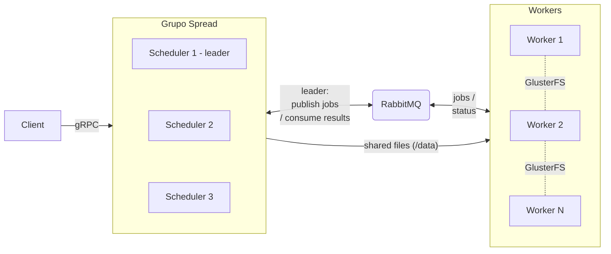
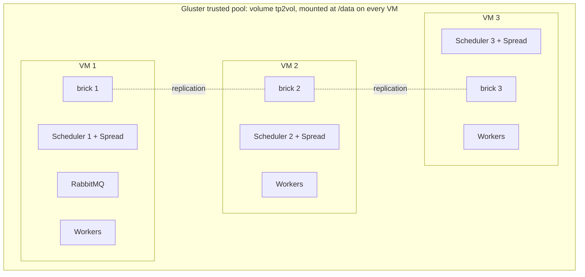
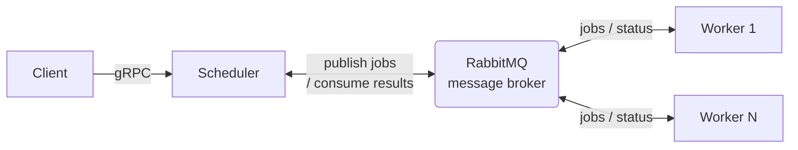
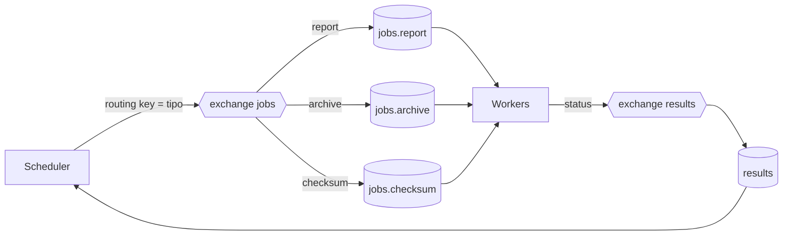
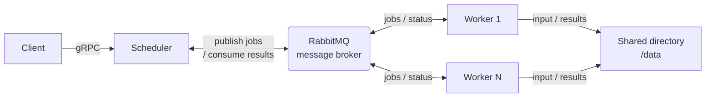
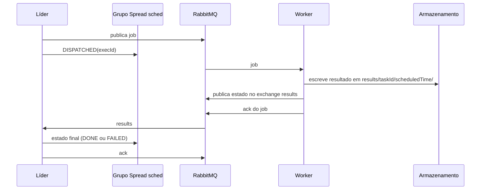

# Cron Distribuído — Agendador de Tarefas Tolerante a Falhas

## **Data limite para entrega no Moodle:** 14 de dezembro de 2026

> **Uso de ferramentas de IA generativa:** de acordo com o [código de conduta académica do ISEL](https://www.isel.pt/sites/default/files/SGAAE/PRE_RG_16_01_Codigo%20Conduta%20Academica%20ISEL.pdf), devem indicar se utilizaram, e de que forma, ferramentas de IA generativa para desenvolver os artefactos entregues (relatório e código fonte).

> **Relatório:** juntamente com o código fonte, deve ser entregue um relatório curto (máximo 5 páginas, em PDF) que inclua:
> - As principais decisões de desenho (ex.: estrutura das mensagens, gestão do estado no agendador, tratamento de reentregas no worker);
> - as evidências das demonstrações de cada fase (ex.: excertos de logs, capturas de ecrã, saídas do `WatchExecutions` e conteúdo das diretorias de resultado);
> - as limitações conhecidas e os aspetos não implementados;
> - a declaração de uso de ferramentas de IA generativa, indicando quais foram usadas e para quê.

## 1. Contexto

Muitos sistemas precisam de executar tarefas periódicas, como gerar relatórios, comprimir ficheiros antigos, verificar a integridade de dados ou limpar diretorias temporárias. Quando apenas uma máquina é suficiente, ferramentas como o [`cron`](https://en.wikipedia.org/wiki/Cron) resolvem o problema. No entanto, uma só máquina limita o número de tarefas que é possível executar e, se falhar, nenhuma tarefa corre. Distribuir o cron por vários nós resolve estes limites, mas cria duas novas dificuldades:

- se todos os nós desencadearem a execução das tarefas, cada tarefa corre N vezes;
- se só um nó desencadear a execução, e esse nó falhar, as tarefas deixam de correr.

O objetivo deste trabalho é construir um agendador distribuído em que apenas um nó (o líder) desencadeia as tarefas. A execução é feita por um conjunto escalável de *workers* e o sistema continua a funcionar corretamente em cenários de falha de um agendador ou um worker.

O trabalho está organizado em quatro fases incrementais. O middleware Spread, a introduzir na fase 3, será usado para eleição de líder e difusão de mensagens no grupo de agendadores. O Gluster File System será usado na fase final para partilha de ficheiros entre VMs.

| Fase | Foco                                                    | O que fica a funcionar no fim da fase                                                                                                          |
| ---- | ------------------------------------------------------- | ---------------------------------------------------------------------------------------------------------------------------------------------- |
| 1    | Contratos gRPC, topologia RabbitMQ e fluxo de mensagens | Tarefas registadas e disparadas por um agendador único; os workers recebem os jobs e apenas os registam em log                                 |
| 2    | Execução real das tarefas                               | Os workers executam os tipos de tarefa predefinidos sobre uma diretoria partilhada; o agendador continua a ser único (líder fixo, sem eleição) |
| 3    | Eleição de líder                                        | Três réplicas do agendador num grupo Spread; só o líder dispara; falha do líder sem perda de ocorrências                                       |
| 4    | GlusterFS                                               | Dados de entrada e resultados num sistema de ficheiros distribuído e replicado; sistema completo distribuído por 3 VMs                         |

### 1.1. Material fornecido

As tarefas são de **tipos predefinidos**, para que não se execute código arbitrário enviado pelo cliente: `report` (relatório CSV com os totais por produto, a partir de ficheiros de vendas), `archive` (arquivo `.tar.gz` de uma diretoria) e `checksum` (manifesto SHA-256 dos ficheiros de uma diretoria). Juntamente com este enunciado são fornecidos os seguintes artefactos:

| Artefacto            | Conteúdo                                                                                                                                                                                                                                                                        | Usado a partir de |
| -------------------- | ------------------------------------------------------------------------------------------------------------------------------------------------------------------------------------------------------------------------------------------------------------------------------- | ----------------- |
| `tasks/`             | Código e `Dockerfile` da imagem de tarefas (`tp2-tasks:1.0`), que implementa os tipos `report`, `archive` e `checksum`. O [`README.md`](tasks/README.md) descreve como construir a imagem, o contrato de invocação (argumentos e códigos de saída) e como integrá-la no worker. | Fase 2            |
| `data.zip`           | Dados de entrada das tarefas: ficheiros de vendas (`input/sales`) e uma árvore de documentos (`input/documents`), e a diretoria `results/`, vazia. Descomprime-se para `/data`.                                                                                                 | Fase 2            |
| `SchedulerMock.java` | Exemplo autocontido do ciclo de disparo do agendador (ver [2.2. Agendamento](#22-agendamento)).                                                                                                                                                                                 | Fase 1            |

A imagem de tarefas e os dados são usados tal como fornecidos: não é preciso alterar o código da imagem, e o trabalho consiste em construir o agendador e os workers que a utilizam. Cada tipo lê uma diretoria de entrada e escreve apenas na diretoria de resultado, sem alterar os dados de entrada.


## 2. Arquitetura final

O diagrama seguinte mostra o sistema completo, tal como ficará no final da fase 4. As secções seguintes descrevem o contributo das fases 1 e 2 para o sistema completo; o detalhe das fases 3 e 4 será dado posteriormente.



<!--
Para minimizar o números de VM necessárias a versão final do sistema corre em 3 VM. Cada VM tem todos os papéis: uma réplica do agendador (com o daemon Spread), um ou mais workers e um brick do volume GlusterFS. O RabbitMQ corre numa das VM. Os bricks são réplicas uns dos outros e todas as VMs montam o mesmo volume em `/data`. O diagrama seguinte detalha essas VMs:



Todos os componentes (agendadores, workers, RabbitMQ, Spread, Gluster) correm como processos no sistema operativo das VMs. Apenas a execução das tarefas é feita em contentores, lançados pelos workers.
-->

### 2.1. Componentes

**Serviço de agendamento** (3 réplicas, num grupo Spread, a partir da fase 3)
- Guarda as definições das tarefas: id, periodicidade e tipo.
- Guarda o estado das execuções e o seu histórico.
- Apenas o líder dispara tarefas.

**Workers** (N réplicas, sem estado)
- Executam cada job lançando um contentor da imagem de tarefas, com o tipo e a diretoria de entrada do job como argumentos.  
- Nas fases 1 a 3 assume-se que os workers executam todos na mesma VM. Na fase 4 será configurado um sistema de ficheiros partilhado em cluster com 3 VM. Nessa fase os workers são distribuídos pelas VM do cluster.
- Consomem as filas `jobs.<tipo>` com ack manual.
- Publicam o estado da execução (`DONE`/`FAILED`) no exchange `results`, que o encaminha para a fila `results`. Esta mensagem não contém o resultado, apenas a sua localização no armazenamento partilhado (`result_path`).

**RabbitMQ**
- Uma work queue por tipo de tarefa: `jobs.report`, `jobs.archive` e `jobs.checksum`.
- Exchange `results` (tipo *fanout*), onde os workers publicam o estado das execuções, e fila `results`, ligada a este exchange, consumida pelo agendador.

**GlusterFS** (fase 4)
- Os servidores Gluster correm em 3 VMs: cada VM tem um brick, e o conjunto dessas VMs forma o [*trusted storage pool*](https://docs.gluster.org/en/main/Administrator-Guide/Storage-Pools/) do volume (ex.: 3 VMs, `replica 3`).
- Cada VM monta o volume localmente em `/data`: os workers leem os dados de entrada e escrevem os resultados através desse ponto de montagem, e os agendadores podem usá-lo, por exemplo, para validar no `RegisterTask` que o `input_dir` existe.
- Guarda os dados de entrada das tarefas (ex.: ficheiros de vendas para relatórios, diretorias a arquivar) e os resultados em `/data/results/<taskId>/<scheduledTime>/`.

### 2.2. Agendamento

Para facilitar a demonstração do sistema, a periodicidade de uma tarefa é dada como um intervalo em segundos (`interval_seconds`) em vez de uma [expressão cron](https://en.wikipedia.org/wiki/Cron#Cron_expression) completa.

As ocorrências de uma tarefa são em instantes fixos, calculados a partir do instante de registo `t0`:

```
scheduledTime(k) = t0 + k × interval_seconds,   k = 1, 2, 3, …
```

O `t0` é fixado uma única vez, no registo da tarefa. O `scheduledTime` de cada ocorrência é o instante planeado, obtido pela fórmula acima. A cada tick (ex.: de segundo a segundo), o agendador lê o relógio e dispara todas as ocorrências com `scheduledTime ≤ agora` que ainda não foram disparadas.

O pseudocódigo seguinte mostra o ciclo de disparo que o agendador tem de implementar. A cada *tick*, calcula o `scheduledTime` das ocorrências em atraso, gera o respetivo `execId` e publica o job. Para isso, cada tarefa guarda o `t0` e o índice `k` da próxima ocorrência a disparar (inicialmente `k = 1`):

```
a cada tick:
    agora ← relógio atual (segundos desde a epoch)
    para cada tarefa t registada:
        enquanto t.t0 + t.k × t.interval_seconds ≤ agora:
            scheduledTime ← t.t0 + t.k × t.interval_seconds
            execId ← t.id + "-" + scheduledTime
            publicar job (execId, t, scheduledTime) em jobs.<t.type>
            t.k ← t.k + 1
```

Normalmente, cada tick dispara apenas uma ocorrência por tarefa. O ciclo `enquanto` só dispara mais do que uma quando um tick se atrasa mais do que o intervalo da tarefa.

O ficheiro [`SchedulerMock.java`](SchedulerMock.java), fornecido em anexo, é um exemplo autocontido deste algoritmo em Java: implementa o ciclo de disparo com um `ScheduledExecutorService`, publica os jobs num *dispatcher* simulado que apenas os escreve na consola, e mostra o `TriggerNow` e o efeito de um tick atrasado.

#### *Exemplo*

Duas tarefas registadas às 12:00:05:

```jsonc
{ "type": "archive", "interval_seconds": 30, "input_dir": "/data/input/documents" }   // id atribuído: t7

{ "type": "report",  "interval_seconds": 60, "input_dir": "/data/input/sales" }       // id atribuído: t8
```

| Instante | Ocorrências disparadas                                             |
| -------- | ------------------------------------------------------------------ |
| 12:00:35 | `t7` (k = 1)                                                       |
| 12:01:05 | `t7` (k = 2), `t8` (k = 1)                                         |
| 12:01:35 | `t7` (k = 3)                                                       |
| 12:01:50 | `TriggerNow(t8)`: ocorrência extra, com `scheduledTime` = 12:01:50 |
| 12:02:05 | `t7` (k = 4), `t8` (k = 2)                                         |

O `TriggerNow` cria uma ocorrência adicional com `scheduledTime` igual ao instante do pedido e não altera o ciclo normal da tarefa. No `execId`, o `scheduledTime` é representado em segundos desde a *epoch* (ex.: `t7-1761566435`).


## 3. Fase 1: Contratos gRPC, topologia RabbitMQ e fluxo de mensagens

### 3.1. Objetivo

Nesta fase pretende-se colocar todas as peças a comunicar mas sem executar nenhuma tarefa em concreto. Existe nesta fase **um único agendador**. Os workers recebem os jobs e limitam-se a escrever na consola (*log*) o que executariam. O que se pretende validar é o contrato gRPC, a topologia RabbitMQ e o percurso completo de uma execução: disparo -> job -> worker → resultado -> histórico.



### 3.2. API gRPC (esboço)

```protobuf
syntax = "proto3";

service Scheduler {
  rpc RegisterTask (TaskDef) returns (TaskId);
  rpc TriggerNow (TaskId) returns (ExecId);
  rpc ListTasks (Empty) returns (stream TaskDef);
  rpc ListExecutions (TaskId) returns (stream Execution);
  rpc WatchExecutions (Empty) returns (stream Execution);
}

message TaskDef {
  string id = 1;
  string type = 2;                  // report, archive, checksum
  int32 interval_seconds = 3;
  string input_dir = 4;             // ex.: /data/input/sales
}

message Execution {
  string exec_id = 1;               // taskId-scheduledTime (ex.: t7-1761566435)
  string task_id = 2;
  int64 scheduled_time = 3;
  string state = 4;                 // DISPATCHED, DONE, FAILED
  string result_path = 5;           // preenchido em DONE
  string error = 6;                 // preenchido em FAILED
}

message TaskId { string id = 1; }
message ExecId { string id = 1; }
message Empty {}
```

| Método            | Descrição                                                                                                                                               |
| ----------------- | ------------------------------------------------------------------------------------------------------------------------------------------------------- |
| `RegisterTask`    | Regista uma nova tarefa periódica, com tipo, intervalo e diretoria de entrada. O agendador atribui-lhe um identificador, que é devolvido ao cliente.    |
| `TriggerNow`      | Dispara de imediato uma ocorrência da tarefa, fora do seu ciclo normal, e devolve o `execId` da execução criada.                                        |
| `ListTasks`       | Devolve, em stream, as definições de todas as tarefas registadas.                                                                                       |
| `ListExecutions`  | Consulta o histórico de uma tarefa: devolve, em stream, as execuções já registadas e termina.                                                           |
| `WatchExecutions` | Subscrição: mantém o stream aberto e envia ao cliente cada mudança de estado de qualquer execução, a partir do momento em que se liga, até se desligar. |

O contrato inclui o `result_path` que só é usado em fases posteriores.

### 3.3. Topologia RabbitMQ



- Exchange `jobs` (tipo *direct*): o agendador publica cada job com routing key igual ao tipo da tarefa, e o exchange encaminha-o para a fila desse tipo.
- Uma work queue por tipo de tarefa (`jobs.<tipo>`), duráveis, com mensagens persistentes. Admite-se que um job publicado no RabbitMQ não se perde.
- Os workers consomem com ack manual para que uma mensagem só seja retirada da fila depois de tratada e para que o trabalho seja repartido pelos workers livres.
- Exchange `results` (tipo *fanout*), onde cada worker publica o estado da execução (`DONE`/`FAILED`) e a localização do resultado no armazenamento partilhado (`result_path`). O exchange encaminha todas as mensagens para a fila `results`, ligada a ele, que é consumida pelo agendador.
- As mensagens não transportam ficheiros, nem nos jobs nem nos resultados. Mensagens grandes ocupam memória do broker e atrasam a entrega das restantes. Por isso, os dados de entrada e os resultados ficam no armazenamento partilhado e as mensagens levam apenas referências para eles.


### 3.4. Exemplos de mensagens trocadas através do RabbitMQ

```jsonc
// jobs.<tipo>
{ "exec_id": "t42-1761566400", "task_id": "t42", "type": "report",
  "scheduled_time": 1761566400, "input_dir": "/data/input/sales" }

// results
{ "exec_id": "t42-1761566400", "task_id": "t42", "state": "DONE",
  "worker": "worker-2", "result_path": "", "error": "" }
```

### 3.5. Demonstração (*checkpoint*)

- Registar duas tarefas de tipos diferentes e mostrar, com `WatchExecutions`, as execuções a sucederem-se.
- Mostrar o uso da operação `TriggerNow`.
- Aumentar o número de workers e mostrar a repartição dos jobs nos logs.
- Terminar um worker durante um job "longo" (simulado com `sleep`) e mostrar que a mensagem, por não ter tido ack, é reentregue a outro worker.

---

## 4. Fase 2: Execução das tarefas (agendador único, sem eleição)

### 4.1. Objetivo

Os workers passam a executar efetivamente os tipos de tarefa predefinidos, lançando um contentor da imagem de tarefas por cada job. O agendador continua a ser **uma única instância**, com o estado (definições das tarefas e histórico de execuções) apenas em memória. Os dados de entrada e os resultados ficam numa diretoria `/data`, montada nos contentores dos jobs (`-v /data:/data`). Como os workers correm todos na mesma VM, a diretoria do *host* é partilhada por todos os workers.

A estrutura de diretorias é a mesma que será usada no GlusterFS na fase 4, para que nessa altura a mudança seja apenas a configuração do GlusterFS:

```
/data/input/...                          dados de entrada das tarefas
/data/results/<taskId>/<scheduledTime>/  resultados das execuções
```



### 4.2. Execução de um job no worker

Para cada job recebido, o worker:

1. Cria a diretoria de resultado `results/<taskId>/<scheduledTime>/`, remove um eventual contentor anterior do mesmo job (`docker rm -f job-<execId>`) e lança o contentor da tarefa com o tipo, a diretoria de entrada (`--input`) e a diretoria de resultado (`--output`).

   Por exemplo, para o job `t8-1761566465` de uma tarefa `report` com `input_dir` igual a `input/sales`, o worker faz o equivalente a:

   ```bash
   mkdir -p /data/results/t8/1761566465
   docker run --rm --name job-t8-1761566465 -v /data:/data tp2-tasks:1.0 report --input input/sales --output results/t8/1761566465
   ```

   Os caminhos `--input` e `--output` são relativos a `/data`, a diretoria de trabalho do contentor. O nome `job-<execId>` identifica o contentor do job: se um worker terminar a meio, o seu contentor continua a correr, e o worker que recebe o job reentregue tem de o remover antes de lançar o novo. Caso contrário, o `docker run` falha por o nome já estar em uso, e ficariam dois contentores a escrever na mesma diretoria. A imagem aceita ainda as opções `--duration N` e `--fail`, que simulam, respetivamente, uma tarefa longa e uma tarefa que falha, e são úteis nas demonstrações.

2. Determina o estado da execução pelo código de saída do contentor: `0` corresponde a `DONE`, com o `result_path`; qualquer outro valor corresponde a `FAILED`, com a mensagem de erro do contentor.
3. Publica o estado no exchange `results` e só depois faz ack do job.

O RabbitMQ garante entrega *at-least-once*: se um worker terminar antes de fazer ack, o job é reentregue a outro worker, que o volta a executar. Como a diretoria de resultado depende apenas do `execId` e as tarefas são deterministas, a nova execução reescreve a mesma diretoria e produz o mesmo resultado, não havendo dois resultados para o mesmo `execId`. Aceita-se que, enquanto a tarefa é reexecutada, a diretoria possa conter um resultado incompleto.

Uma tarefa que falha (código de saída diferente de 0) não é repetida e por isso o worker publica `FAILED` e faz ack. Como o mesmo estado pode chegar mais do que uma vez para o mesmo `execId` (ex.: o worker publica o estado e termina antes do ack), o agendador deve tratar as mensagens de `results` como atualizações idempotentes.

### 4.3. Requisitos base

- Execução dos tipos de tarefa através da imagem fornecida (ver [Material fornecido](#11-material-fornecido)): o worker lança um contentor por job, passando-lhe o tipo e a diretoria de entrada do job, e determina o estado da execução (`DONE`/`FAILED`) pelo código de saída do contentor.
- Diretoria partilhada `/data` com a estrutura indicada acima, montado nos contentores dos jobs.
- Uma diretoria de resultado por `execId` (`results/<taskId>/<scheduledTime>/`); o worker só faz ack do job depois de publicar o estado.

### 4.4. Demonstração (*checkpoint*)

- **Execução de tarefas:** registar uma tarefa de cada tipo e mostrar os resultados em `results/<taskId>/<scheduledTime>/`, com o estado `DONE` no histórico; mostrar também uma tarefa que falha (`--fail` ou `input_dir` inexistente) a terminar com `FAILED`.
- **Reentrega de jobs:** terminar um worker a meio de uma tarefa longa (`--duration`) e mostrar que o job é reentregue a outro worker, que o completa com sucesso.

---

## 5. Fase 3: Eleição do líder com Spread

### 5.1. Alterações ao sistema da fase 2

O objetivo nesta fase é eliminar o ponto único de falha. O agendador passa a ter 3 réplicas, num grupo Spread, mas ainda a executar na mesma máquina. Qualquer réplica aceita pedidos gRPC, mas apenas o líder dispara as tarefas e consome a fila `results`. Quando o líder falha, outra réplica assume esse papel, sem perda de ocorrências.

**O registo de tarefas não precisa de líder.** Qualquer réplica pode receber o pedido gRPC e difundi-lo ao grupo Spread com ordem total. Todas as réplicas aplicam as alterações pela mesma ordem e ficam com o mesmo estado. Para que duas réplicas que recebem pedidos ao mesmo tempo não atribuam o mesmo identificador a tarefas diferentes, o id da tarefa é formado pelo nome da réplica que recebeu o pedido e por um contador local dessa réplica (ex.: `s2-7`). É único sem qualquer coordenação, porque não há duas réplicas com o mesmo nome.

**O disparo precisa de líder.** O disparo periódico de tarefas não é provocado por uma mensagem, mas pela passagem do tempo. Assim, só o líder consulta o seu relógio e dispara as tarefas de acordo com o algoritmo da secção [2.3. Agendamento](#23-agendamento).

**O pedido de TriggerNow pode ser enviado a qualquer réplica.** Ao contrário do disparo periódico, é provocado por uma mensagem (o pedido gRPC), que pode chegar a qualquer réplica. A réplica que o recebe fixa o `scheduledTime` com o instante do pedido, difunde `TRIGGER(taskId, scheduledTime)` ao grupo e devolve o `execId` ao cliente. Só o líder publica o job: ao receber o `TRIGGER`, publica-o e difunde `DISPATCHED`, como num disparo periódico. Para simplificar, aceita-se que um `TriggerNow` se perca se o líder falhar nesse instante.

### 5.2. Eleição com Spread

Não é preciso implementar um algoritmo de eleição explícito:

1. Todas as réplicas juntam-se ao grupo `sched`.
2. O Spread entrega a todos os membros a mesma vista de membership, pela mesma ordem relativamente às mensagens.
3. Cada réplica aplica uma regra determinística, por exemplo: **o líder é o membro com o nome mais baixo na vista**.
4. Quando o líder falha, chega uma nova vista e todos concluem, sem trocar mensagens, quem é o novo líder.

Regra do quórum: só há líder se a vista atual contiver a maioria das réplicas configuradas, isto é, pelo menos 2 das 3. Sem maioria, nenhuma réplica dispara tarefas nem consome a fila `results`.

### 5.3. Fluxo de um disparo com líder

1. A cada tick, o líder determina que tarefas estão em atraso.
2. Para cada ocorrência em atraso, gera `execId = taskId-scheduledTime` (determinístico, como na secção [2.3. Agendamento](#23-agendamento)).
3. O líder publica o job em `jobs.<tipo>` e só depois difunde `DISPATCHED(execId)` ao grupo Spread.
4. Um worker consome o job e executa-o (fase 2).
5. O líder consome a fila `results`, difunde o estado final ao grupo e só depois faz ack da mensagem.



A ordem destes passos é o que garante que nenhuma ocorrência se perde quando o líder falha a meio de um disparo:

- **Publicar antes de difundir `DISPATCHED`:** se o líder falhar depois de publicar o job e antes de difundir `DISPATCHED`, o `k` da tarefa não avançou em nenhuma réplica. O novo líder volta a disparar a mesma ocorrência, com o mesmo `execId`, e o job é executado duas vezes, o que é aceitável porque a segunda execução reescreve a mesma diretoria de resultado (ver [4.2](#42-execução-de-um-job-no-worker)). Na fosse realizado na ordem inversa, o `k` avançava sem o job ter sido publicado, e a ocorrência perdia-se.
- **Ack de `results` só depois de difundir:** se o líder falhar depois de receber um estado e antes de o difundir, a mensagem, sem ack, volta à fila `results` e é consumida pelo novo líder. Se o ack fosse feito antes, o estado final perdia-se e a execução ficava para sempre em `DISPATCHED`.

### 5.4. Estado das réplicas

O estado do agendador (tarefas registadas, próxima ocorrência de cada tarefa e histórico de execuções) é mantido **apenas em memória**, em cada réplica, e não é persistido em disco. As réplicas mantêm-no igual através do Spread, como uma máquina de estados replicada: todas as alterações são difundidas ao grupo com ordem total, e cada réplica aplica-as pela mesma ordem.

Em cada réplica, o estado é formado por:

- **Tarefas:** para cada tarefa, a definição (`id`, `type`, `interval_seconds`, `input_dir`), o instante de registo `t0` e o índice `k` da próxima ocorrência a disparar (ver [2.3. Agendamento](#23-agendamento)).
- **Execuções:** para cada `execId`, a tarefa, o `scheduledTime`, o estado (`DISPATCHED`, `DONE` ou `FAILED`) e, no fim, o `result_path` ou a mensagem de erro.

As mensagens difundidas ao grupo, e o efeito de cada uma no estado, são:

| Mensagem difundida                | Quem a difunde                  | Efeito no estado                                                                                                                                                                                                    |
| --------------------------------- | ------------------------------- | ------------------------------------------------------------------------------------------------------------------------------------------------------------------------------------------------------------------- |
| `REGISTER(task, t0)`              | A réplica que recebe o pedido   | Acrescenta a tarefa, com o id e o `t0` fixados pela réplica que recebeu o pedido e `k = 1`                                                                                                                          |
| `TRIGGER(taskId, scheduledTime)`  | A réplica que recebe o pedido   | Nenhum nas outras réplicas; o líder, ao recebê-la, publica o job e difunde `DISPATCHED`                                                                                                                             |
| `DISPATCHED(execId)`              | O líder                         | Acrescenta a execução no estado `DISPATCHED`. Se for a ocorrência periódica `k` da tarefa, incrementa o `k` (`k ← k + 1`): a próxima ocorrência a disparar passa a ser a seguinte. Num `TriggerNow`, o `k` não muda |
| `DONE(execId)` / `FAILED(execId)` | O líder (ao consumir `results`) | Muda o estado da execução para `DONE` (com o `result_path`) ou `FAILED` (com a mensagem de erro)                                                                                                                    |

Assim, quando o líder falha, o novo líder já tem o estado atualizado e retoma o disparo a partir dele. Uma réplica que entra no grupo recebe o estado completo de um membro atual (*state transfer*) antes de começar a responder a pedidos.

Como o estado só existe em memória, perde-se se todas as réplicas falharem ao mesmo tempo. Admite-se no contexto deste trabalho que isso não acontece.

### 5.5. Requisitos base

- 3 réplicas do agendador no grupo Spread, o qual é usado para membership e eleição pela regra determinística.
- Só o líder dispara e consome a fila `results`; uma réplica que deixa de ser líder deixa de disparar e cancela o seu consumidor de `results`.
- O líder só faz ack de uma mensagem de `results` depois de difundir o estado ao grupo.
- O líder publica o job e só depois difunde `DISPATCHED(execId)` ao grupo.
- Regra do quórum: só há líder se a vista atual tiver maioria, ou seja, 2 ou mais réplicas das 3 definidas no sistema.
- *State transfer*: uma réplica que entra no grupo recebe de um membro atual o estado completo antes de começar a responder a pedidos.
- Na mudança de líder, o novo líder retoma o disparo a partir do estado replicado que já tem em memória: dispara todas as ocorrências em atraso, com o `scheduledTime` original.

### 5.6. Demonstração (checkpoint)

- **Falha do líder antes de um disparo:** terminar o líder segundos antes de uma ocorrência e mostrar que a tarefa é disparada, com atraso, pelo novo líder.
- **Entrada de um novo elemento no grupo:** com o sistema já em funcionamento, com tarefas registadas e execuções no histórico, arrancar uma nova réplica e mostrar que, ao entrar no grupo, recebe o estado atual (ex.: com `ListTasks` e `ListExecutions` dirigidos a essa réplica).

---

## 6. Fase 4

O detalhe da fase 4 (GlusterFS) será publicado posteriormente, numa nova versão deste enunciado.
